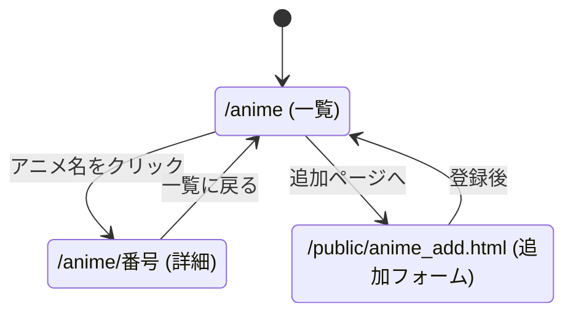
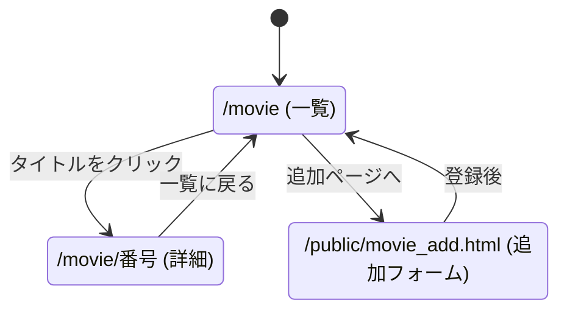

# レポート用システムの設計

京葉線システム以外に、次の3つのWebアプリケーションを開発する。
データはすべて、サーバのプログラム内の変数に記録する。

| システム | 題材 | URLの名前 |
|---|---|---|
| A | アニメの管理 | /anime |
| B | ゲームの管理 | /game |
| C | 映画の管理 | /movie |

---

## システムA:アニメの管理

### 対象と目的

- 対象:放送されるアニメ(春・夏・秋・冬の期ごとに入れ替わる)
- 目的:アニメの一覧と詳細を見られるようにし、新しい期のアニメを追加できるようにする

### スキーマ(データの構造)

| 項目名 | 型 | 説明 | 例 |
|---|---|---|---|
| id | 数値 | 通し番号 | 1 |
| title | 文字列 | アニメの名前 | 【アニメ名】 |
| studio | 文字列 | 制作会社 | 【制作会社】 |
| genre | 文字列 | ジャンル | 【ジャンル】 |
| year | 数値 | 放送年 | 2026 |
| season | 文字列 | 放送の期(春・夏・秋・冬) | 秋 |
| services | 文字列 | 見られるサブスク(複数ならカンマ区切り) | 【サブスク1】，【サブスク2】 |

### ページ遷移図

### 今後の拡張(案)

- 一覧を、放送の期(year と season)ごとに絞り込めるようにする

---

## システムB:ゲームの管理

### 対象と目的

- 対象:自分が遊んだ(遊びたい)ゲーム
- 目的:ゲームの一覧と詳細を見られるようにし、あとからゲームを追加できるようにする

### スキーマ(データの構造)

| 項目名 | 型 | 説明 | 例 |
|---|---|---|---|
| id | 数値 | 通し番号 | 1 |
| title | 文字列 | ゲームの名前 | 【ゲーム名】 |
| platform | 文字列 | 遊ぶ機種 | 【機種】 |
| genre | 文字列 | ジャンル | 【ジャンル】 |
| hours | 数値 | 遊んだ時間(時間) | 10 |

### ページ遷移図

### 今後の拡張(案)

- 遊んだ時間(hours)を、あとから更新できるようにする

---

## システムC:映画の管理

### 対象と目的

- 対象:観た(観たい)映画
- 目的:映画の一覧と詳細を見られるようにし、観た映画を追加できるようにする

### スキーマ(データの構造)

| 項目名 | 型 | 説明 | 例 |
|---|---|---|---|
| id | 数値 | 通し番号 | 1 |
| title | 文字列 | 映画のタイトル | 【映画名】 |
| director | 文字列 | 監督 | 【監督名】 |
| year | 数値 | 公開年 | 2001 |
| minutes | 数値 | 上映時間(分) | 125 |
| genre | 文字列 | ジャンル | 【ジャンル】 |

### ページ遷移図

### 今後の拡張(案)

- 一覧を、公開年の順に並べられるようにする